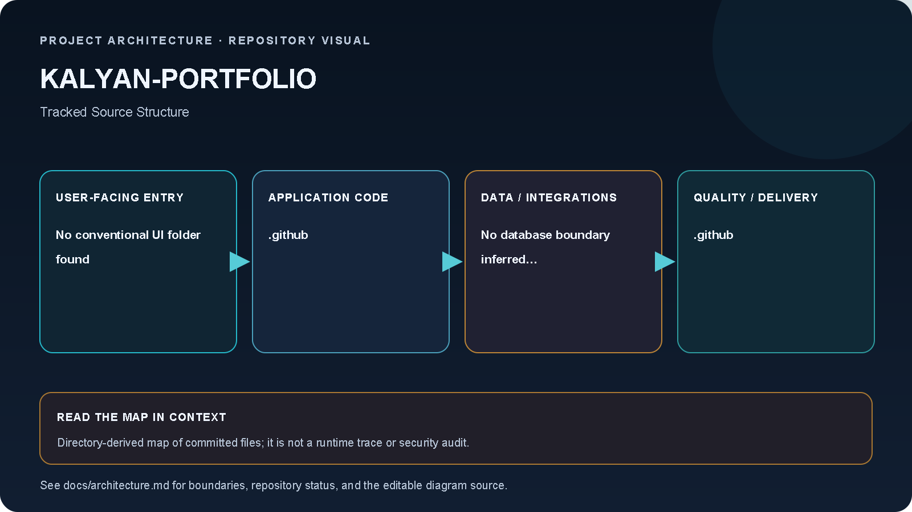
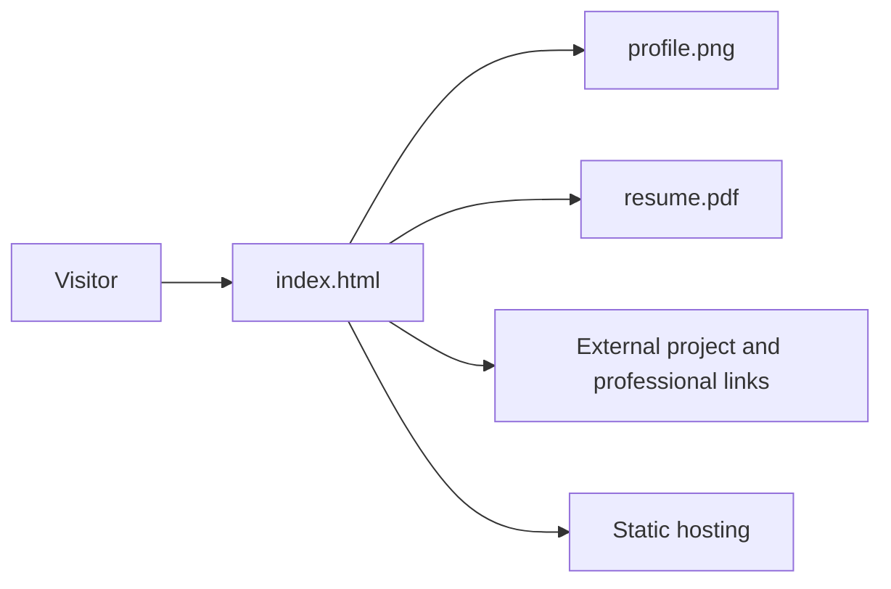

# Kalyan Portfolio

<strong>A personal portfolio for presenting Kalyan's student profile, selected work, skills, and resume.</strong>

**Live link:** [https://kalyan-portfolio95.netlify.app/](https://kalyan-portfolio95.netlify.app/)

Static web · HTML · CSS · JavaScript

## Project overview

The repository contains a single-page portfolio, a profile image, and a downloadable PDF resume. The page introduces Kalyan as a third-year B.Tech CSE student and links to project and professional profiles.

## Architecture

[Architecture notes](docs/architecture.md) · [Editable SVG](docs/images/kalyan-portfolio-architecture.svg)

## Preview and local use

Open `index.html` in a browser or serve the repository as a static site. No build process or backend is required. The page loads icon and font resources from third-party CDNs when online.

## Publish checklist

- Keep the student year and project list current.
- Verify every external profile and project link.
- Replace the resume PDF when the source resume changes.
- Confirm that `profile.png` and `resume.pdf` remain present after deployment.

## Project structure

- `index.html` — portfolio content, page styling, and interactions
- `profile.png` — profile image
- `resume.pdf` — downloadable resume
- `.github/workflows/codeql.yml` — CodeQL workflow
- `SECURITY.md` — security reporting policy
