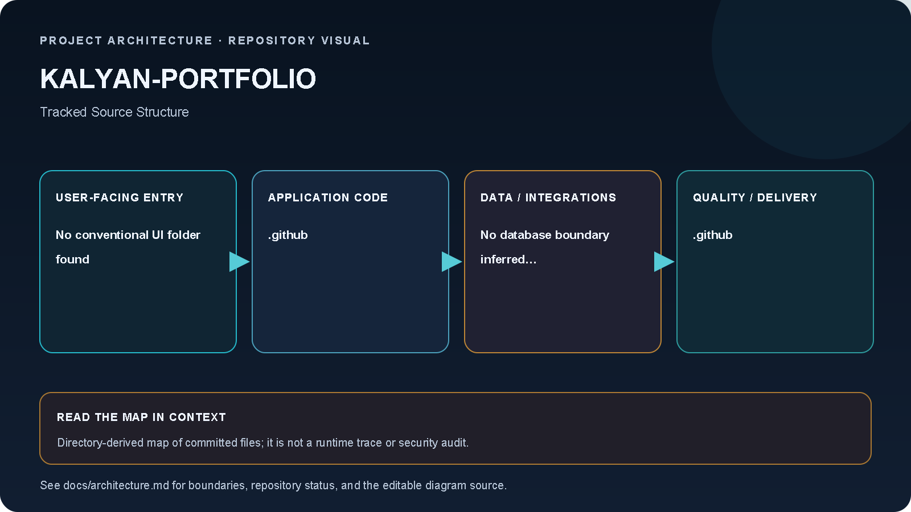

# kalyan-portfolio — architecture and repository status

**Repository:** [https://github.com/kalyan870/kalyan-portfolio](https://github.com/kalyan870/kalyan-portfolio)

**Live link:** https://kalyan-portfolio95.netlify.app/

[Open the editable SVG](images/kalyan-portfolio-architecture.svg)

## What this map represents

Source-tree map; it describes tracked paths and does not claim a tested runtime flow.

## Verified repository facts

- Tracked application/package source is present.
- Default branch: `main`.
- Main language reported by GitHub: `HTML`.
- Top-level tracked directories: `.github`.
- GitHub Actions workflow present: `yes`.
- Existing build/dependency manifests: none detected.

## Security and data boundaries

This documentation update does not add sign-in, a database, or file storage. Those belong only where the application has a verified account, durable relational-data, or persistent uploaded-file requirement. Review the application code and deployment settings before using private user data; this map is not a security audit.

## Run and test

Use the commands already documented in the [project README](../README.md). No setup or test command is invented here.
